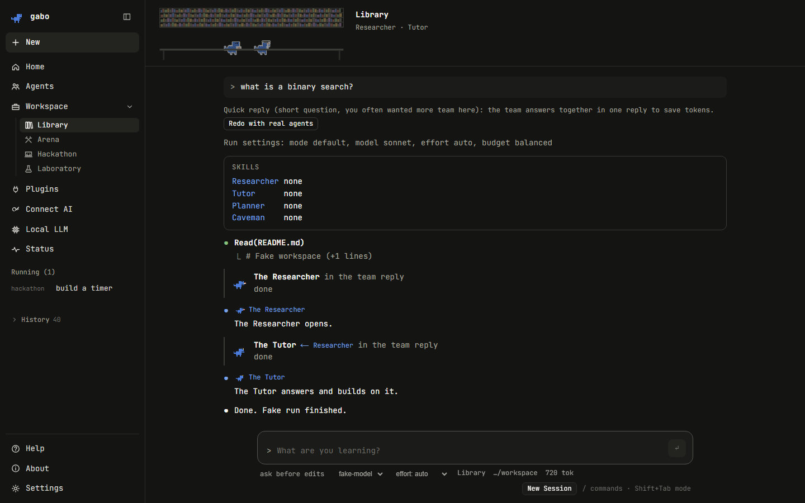
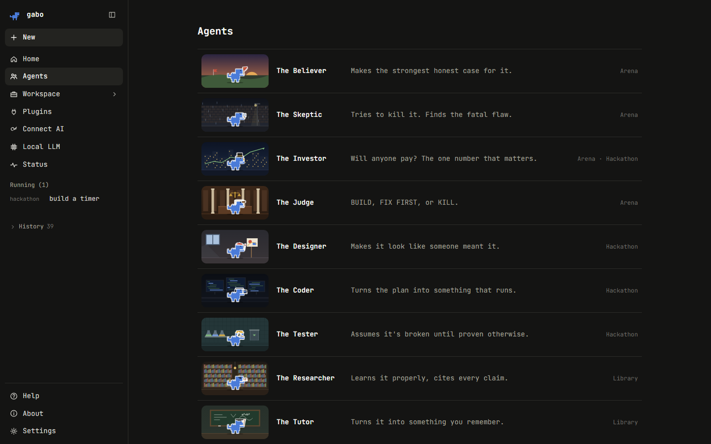
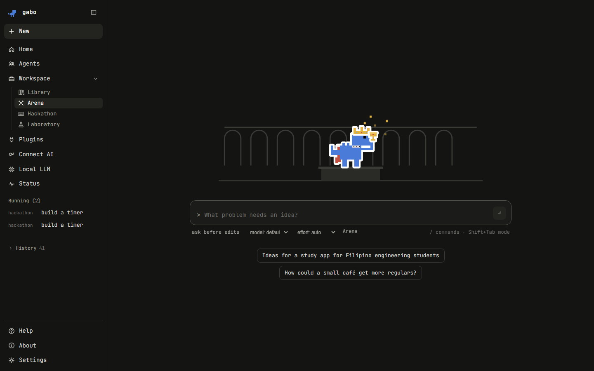
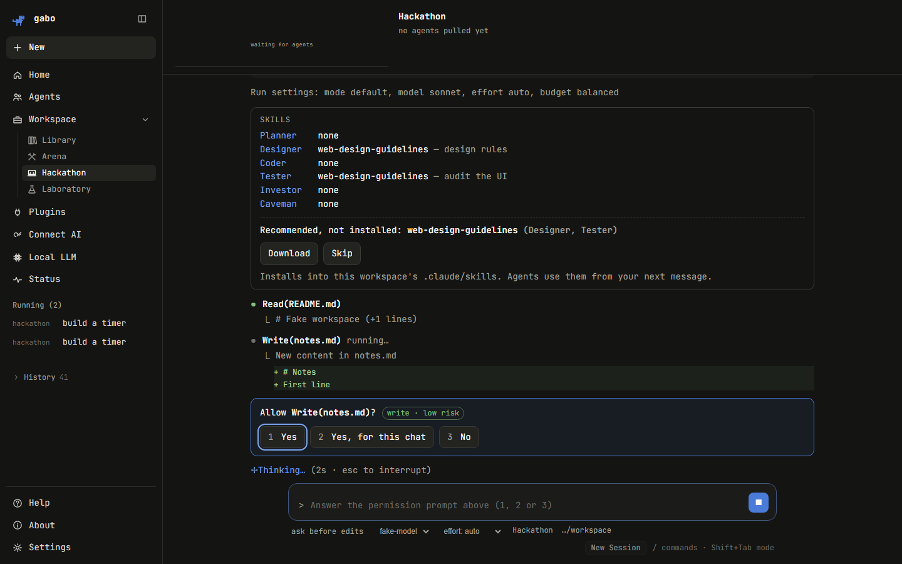
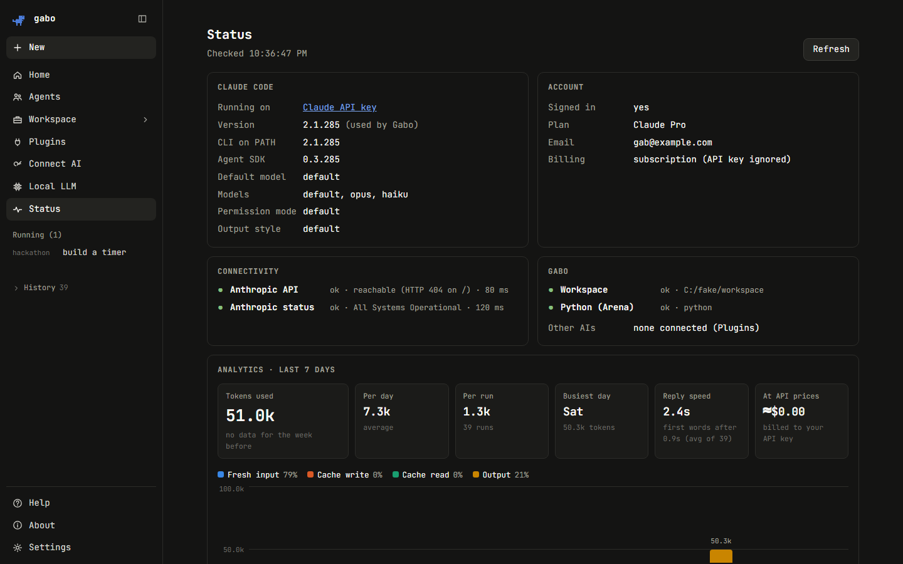
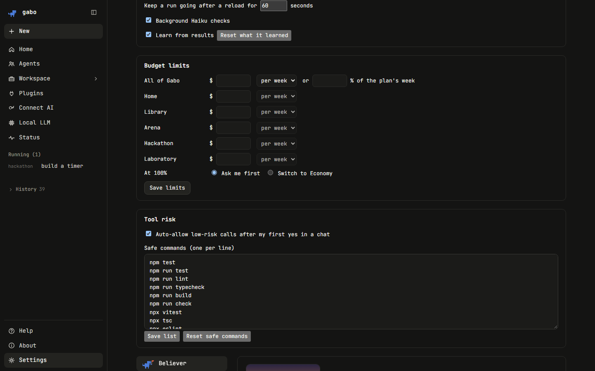
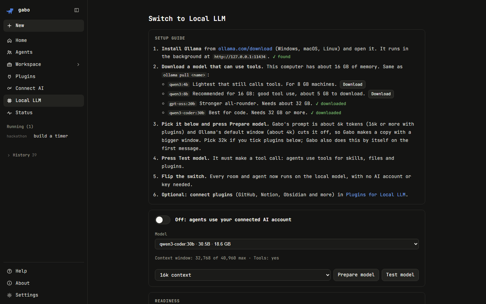
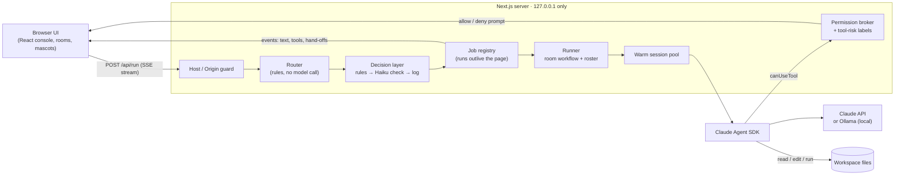

  

<h1 align="center">Gabo</h1>

<strong>A team of twelve AI agents that works on your own computer.</strong> 
Agents hand work to each other, challenge each other and build on each other's output, 
in rooms made for studying, brainstorming and shipping software.

  
  
  
  
  
  

> **This is a showcase repository.** Gabo's source code is private. This page describes what it does and how it
> works. **Source is available on request for recruiters and employers:** see [Contact](#contact).

  

---

## Demo

<!-- Replace the link below with your Loom or YouTube demo. -->
**Video walkthrough:** _coming soon_

---

## The problem

- **One voice.** A single AI assistant agrees with you and misses blind spots. There's no built-in skeptic, investor or tester.
- **Multi-agent tools burn tokens and time.** Every extra agent re-reads its own context. During development, one reply in
  a long chat re-read about **2.3 million tokens**, and a message took **8–9 s** before the first word.
- **Lock-in.** Most agent tools work with one provider.
- **Privacy.** Cloud agent platforms keep your files and chats on their servers.

## What Gabo does

| Need                     | Gabo's answer                                                                                                                   |
| ------------------------ | -------------------------------------------------------------------------------------------------------------------------------- |
| Different viewpoints     | 12 role agents (Believer, Skeptic, Investor, Judge, Designer, Coder, Tester, Researcher, Tutor, Caveman, Planner, Emperor)      |
| A team that fits the job | Rooms: **Library** (study), **Arena** (pick the best idea), **Hackathon** (build and ship), **Laboratory** (you pick the team) |
| Cheap and fast           | A router that sizes the team per message, team-in-one-reply, warm sessions, a context guard, per-agent model budgets          |
| Any AI, or none          | A Claude API key, or a free local model in Ollama                                                                               |
| Private                  | Runs on `127.0.0.1`; keys and chats stay in local files                                                                         |

---

## Features

### Agents and rooms

- **12 agents**, each with a distinct role, a pixel-dinosaur mascot, a costume and its own stage.
- **Library:** the Researcher finds sources, then the Tutor and Planner turn them into a study plan and practice questions.
- **Arena:** the Emperor sharpens the challenge and runs an **idea tournament**. The Believer and Investor argue, the
  Skeptic attacks, and the Judge rules **BUILD**, **FIX FIRST** or **KILL**.
- **Hackathon:** the Planner defines done, the Designer sets direction, the Coder builds, and the Tester tries to break it.
- **Agents talk to each other:** each one agrees with, challenges or builds on its teammates, and the chat shows who
  builds on whom (**Tutor ← Researcher**).
- **Make your own agents:** describe one and Gabo generates its costume and background.

  
  

### A full coding-agent console in the browser

- Tools that read, edit and run code in a workspace folder, with **permission prompts** (allow once, allow for this chat,
  deny) and **plan approval**.
- Permission modes (Shift+Tab), model and effort pickers, `/` commands, `@` file mentions, pasted screenshots, a live
  todo list, edit diffs, message queueing, Esc to stop.
- **Tool risk labels:** low-risk calls are auto-allowed after your first yes; high-risk ones (deleting, network, outside
  the workspace) always ask.
- **Runs survive a reload:** a run lives on the server, not in the page, and re-attaches when you come back.
- **History** of every session, resumable from the app or the terminal.

  

### Control and insight

- **Token budget modes** (Economy, Balanced, Max quality) with a recommended model, effort, tools and output length per agent.
- **Budget limits** per room and overall, with alerts at 50/75/90% and a choice at 100%: ask, or switch to Economy.
- **Analytics:** tokens per day split into fresh input, cache writes, cache reads and output; reply speed; change from last week.
- **Decision layer:** every quick choice (tier, team, skills, tool risk) is logged with its outcome and exportable as JSONL
  for training a decision model.

  
  

### Local LLM mode (free, private, offline)

- A setup guide for Ollama, a model picker sized to your computer's memory, one-click **Prepare model** (context window)
  and **Test model** (it must make a real tool call).
- A slim prompt for small models, skills picked by keyword match (no cloud calls), and opt-in plugins: GitHub, Notion,
  Obsidian or any MCP server.

  

---

## How it works

### Architecture

### The router: how much team does a message need?

Before anything runs, a **rule-based router** (no AI, so no delay and no tokens) scores the message: things you ask it to
produce, amounts ("3 examples"), extra steps ("then…"), lookups, images and length. Plain short questions score low.

| Tier         | When                                   | What happens                                                                 |
| ------------ | -------------------------------------- | ---------------------------------------------------------------------------- |
| **Quick**    | Short, plain questions                 | One model writes two agents' turns in a single reply, each answering the other |
| **Standard** | Regular tasks                          | The same, plus at most one real agent when a role needs tools                 |
| **Deep**     | Build work, long tasks, the tournament | Real agents, with independent ones running **in parallel**                    |

Each reply shows its tier and why, with a **Redo with real agents** button. Corrections shift that room's future scores,
so the router learns each room's habits.

The single-reply mode is based on **Solo Performance Prompting** (Wang et al.): one strong model playing several
collaborating expert personas.

### Token and latency engineering

| Technique                    | Effect                                                                                        |
| ---------------------------- | --------------------------------------------------------------------------------------------- |
| Router + team in one reply   | **47% fewer tokens** on a measured task (39.8k vs 75.4k), first words **5 s sooner**          |
| Per-agent model budget       | Opus only where the call decides the result (Judge, Coder, Emperor), Haiku/Sonnet elsewhere   |
| Context guard                | Warns at 150k tokens re-read per message, asks before 400k, offers a compacted New Session   |
| Cache-safe prompt design     | System prompt and tool list never change between messages, so the prompt cache keeps hitting |
| Trimmed hand-offs            | The next agent gets a summary line and 3 key points, not the whole previous output           |
| Warm sessions + spare process | Message start time down from **9.3 s to 3.3 s** (2.8 s for a new chat)                      |

### Safety

- The server binds `127.0.0.1`, and every API route rejects non-local hosts and origins (DNS-rebinding protection).
- File tools are locked to the workspace by two independent checks: the permission callback and a pre-tool-use hook.
- Writes, edits and shell commands ask first. Keys never leave the server.

---

## Tech stack

| Layer       | Tools                                                                  |
| ----------- | ---------------------------------------------------------------------- |
| App         | Next.js 16 (App Router), React 19, TypeScript 5.9, plain CSS modules   |
| Agents      | Claude Agent SDK, Model Context Protocol (MCP) SDK, Zod                |
| Local AI    | Ollama (e.g. `qwen3:8b`)                                               |
| Rendering   | react-markdown + remark-gfm                                            |
| Testing     | Vitest (unit), Playwright (end-to-end, against a scripted fake mode)  |

---

## Proof points

- **47% fewer tokens** for a team-in-one-reply answer vs a real-agent run.
- **About 3× faster** first words: 9.3 s → 3.3 s.
- **Local model works with tools** at about 5.6k tokens per prompt (`qwen3:8b`).
- **273 unit tests and 65 browser tests** pass.

---

## Source code

The source code is **private**. If you're a recruiter, hiring manager or collaborator and want to review it, contact me
and I can give you temporary read access.

## Contact

- GitHub: [@Gabi-comm](https://github.com/Gabi-comm)
- Email: <!-- add your preferred contact email -->

---

© 2026 Gab. All rights reserved. See [LICENSE](LICENSE).
